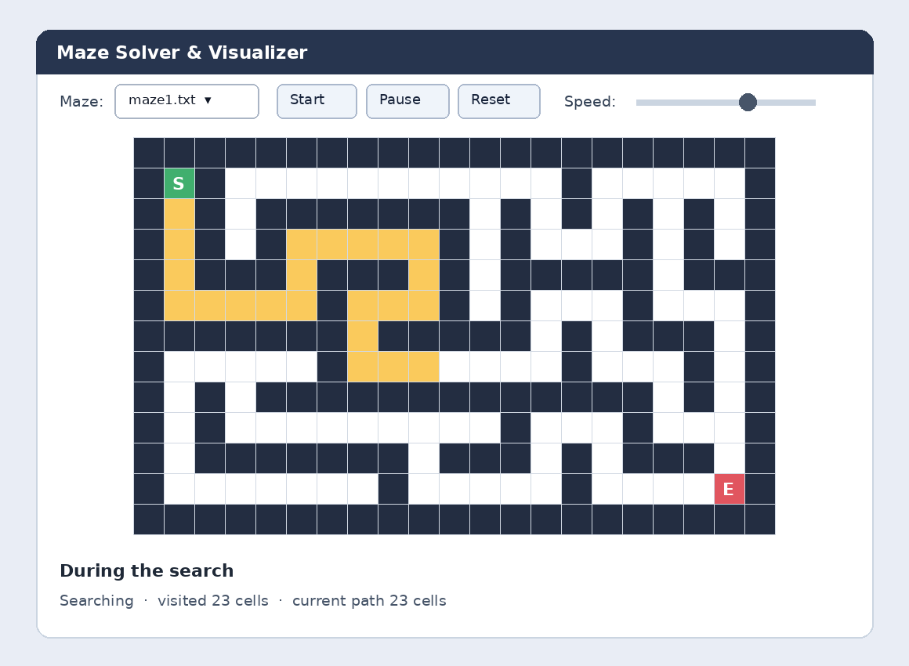
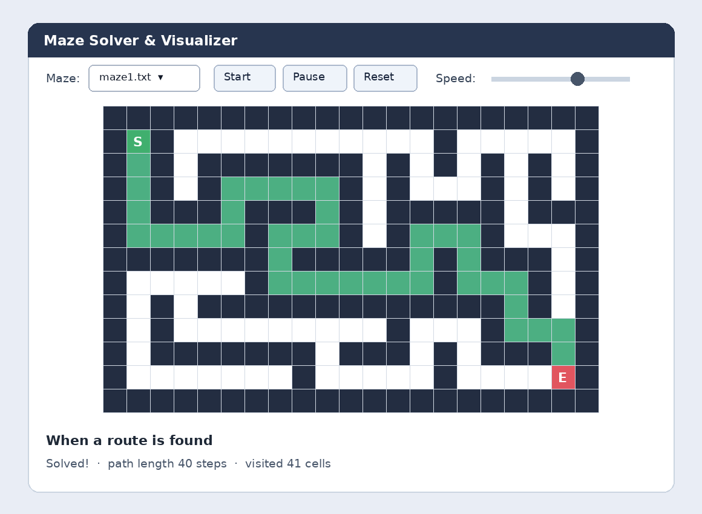
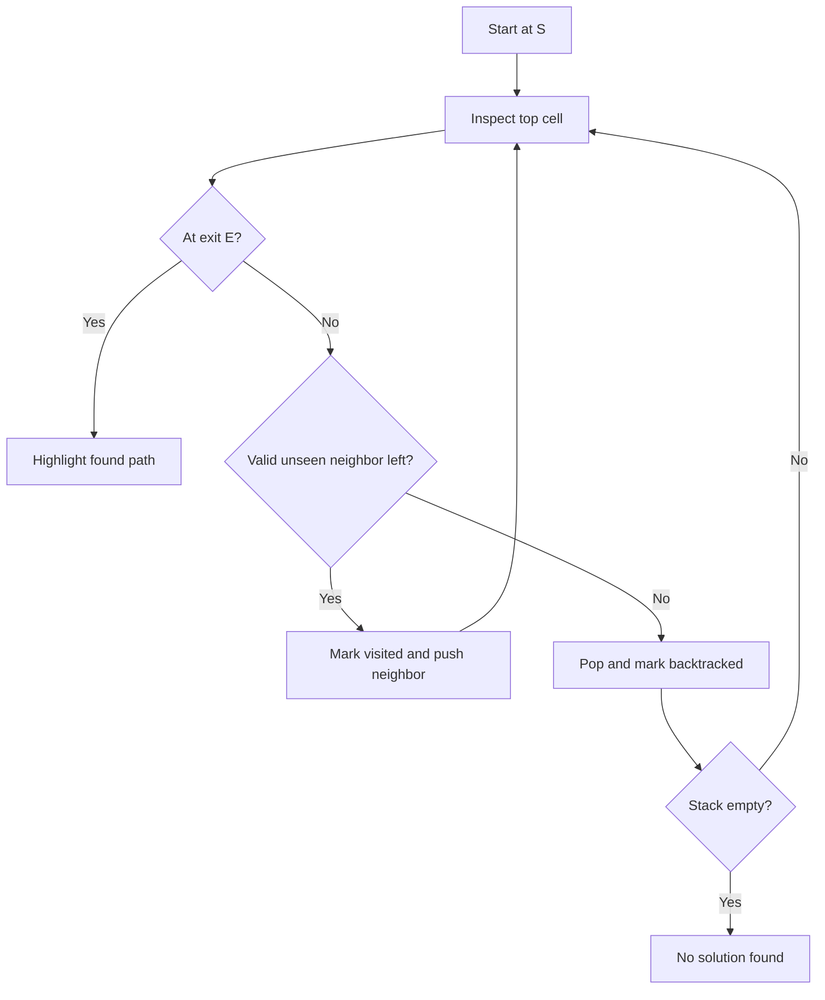

# Java Maze Solver & Visualizer

**See how a computer searches, makes decisions, reaches dead ends, and finds its way out—one cell at a time.**

This is an interactive Java desktop application that turns **depth-first search (DFS)** and **backtracking** into something you can actually watch. Instead of only reading algorithm pseudocode, you can select a maze, start an animated search, pause at an interesting decision, and see which route eventually reaches the exit.

**Made for:** students learning algorithms, beginner Java developers, educators demonstrating graph traversal, and anyone curious about how maze-solving works. No prior experience with DFS is needed to understand the visualizer.

## Preview: what will I see?

The application opens a desktop window with a maze selector, **Start / Pause / Reset** buttons, a **Speed** slider, a color-coded maze, and a progress message underneath.

| While DFS explores | After DFS finds the exit |
| :---: | :---: |
|  |  |

*These are illustrative mockups based on the supplied Java Swing rendering code, **not screenshots from a running copy**. The actual maze shape and path depend on the `mazes/maze1.txt` through `maze5.txt` files in your repository. The source files supplied for this README did not include those maze text files.*

### Understand the colors

| Appearance | Meaning |
| --- | --- |
| Dark navy | A wall (`#`): cannot be crossed |
| White | An unvisited, walkable space |
| Yellow | A cell DFS has visited and may still be exploring |
| Pale blue-gray | A branch DFS explored, then backtracked from |
| Green route | The successful route after the exit is reached |
| Green **S** | Starting cell |
| Red **E** | Exit cell |

The **S** and **E** markers keep their own colors, even after the search finishes.

## Why build or explore this project?

A maze is a practical way to understand a foundational computer science idea: **representing a problem as a graph and searching it systematically**. Every open cell is a possible position (a graph vertex), and moving between adjacent open cells is a connection (an edge).

By watching the animation, you can learn:

- **Depth-first search:** follow one possible route as far as it goes before trying alternatives.
- **Backtracking:** undo progress along a dead-end branch and return to the last unexplored choice.
- **Stacks:** track the active route and the next direction to test at each position.
- **Visited-state tracking:** avoid exploring the same position repeatedly or getting stuck in loops.
- **Algorithm visualization:** connect an abstract algorithm to a changing, observable program state.
- **Java GUI programming:** see how Swing, drawing with `Graphics2D`, and a timer can animate each step without blocking the interface.

DFS is useful beyond mazes: similar traversal ideas appear in graph exploration, connected-component discovery, dependency analysis, and many search problems.

## How the solver thinks

Imagine reaching a fork in a maze. DFS chooses one direction and keeps going. If that branch ends, it returns to the fork and tries a different direction. It repeats until it reaches **E** or exhausts every reachable option.

```text
1. Begin at S; put that cell on the stack and mark it visited.
2. Look at the cell on top of the stack.
3. If it is E, stop and highlight the stack as the found route.
4. Otherwise, try neighbors in order: DOWN → UP → RIGHT → LEFT.
5. If a neighbor is open, in bounds, and unseen, visit and push it.
6. If no directions remain, pop the cell and color it as backtracked.
7. Repeat while the stack contains cells.
8. If the stack empties before reaching E, report no solution.
```



**Important distinction:** DFS will find *a* route if the exit is reachable, but it does **not** guarantee the shortest route. If you want to compare algorithms, breadth-first search (BFS) is a natural next experiment for shortest paths in an unweighted grid.

## Try it yourself

### Requirements

- A **Java Development Kit (JDK)**, version **11 or newer** (as specified in the original project README).
- A graphical desktop on **Windows, macOS, or Linux**. This is a **Swing desktop application**, not a web app.
- The Java source files and the `mazes/` directory containing the five text mazes.

### 1. Get the repository

On GitHub, choose **Code → Download ZIP**, extract it, and open a terminal in the extracted project folder. If you already use Git, you can clone the repository instead.

### 2. Check the project files

Make sure the source filenames are exactly `Maze.java`, `MazeSolver.java`, and `MazeVisualizer.java`, and that `mazes/maze1.txt` through `mazes/maze5.txt` exist. The Java program loads maze files using **relative paths**, so run it from the repository root, not from inside `mazes/`.

### 3. Compile and run

```bash
javac Maze.java MazeSolver.java MazeVisualizer.java
java MazeSolver
```

A window titled **Maze Solver & Visualizer** should appear. If Java reports a missing maze, verify the `mazes/` directory and your current working directory.

### 4. Explore the interface

| Control | What it does |
| --- | --- |
| **Maze** dropdown | Chooses one of five named maze text files and loads it |
| **Start** | Restarts the selected maze and begins animating DFS |
| **Pause / Resume** | Pauses or resumes the animation |
| **Reset** | Reloads the maze and clears search progress |
| **Speed** slider | Changes the delay between steps; moving right makes the animation faster |
| **Status bar** | Shows the grid size, search progress, solution length, or an error |

Try pausing at a dead end. Look for pale blue-gray cells: each one shows a branch that the algorithm abandoned. Then resume and watch the search take another route.

## How the code is organized

```text
Java-Maze-Solver/
├── Maze.java                  # Load and validate a text maze
├── MazeSolver.java            # DFS search, stack, timer, buttons, status
├── MazeVisualizer.java        # Draw the grid and color each state
├── mazes/
│   ├── maze1.txt              # Sample maze selected by the dropdown
│   ├── maze2.txt
│   ├── maze3.txt
│   ├── maze4.txt
│   └── maze5.txt
├── assets/
│   ├── maze-search-preview.png
│   └── maze-solved-preview.png
└── README.md
```

**`Maze.java` — input and validation.** Reads a text file into a two-dimensional `char[][]`, checks that every row has the same width, allows only `#`, spaces, `S`, and `E`, and requires exactly one start and exit.

**`MazeSolver.java` — behavior and algorithm.** Creates the Swing window and controls, loads the chosen maze, advances DFS using `javax.swing.Timer`, tracks cells in a `Deque` stack, marks visited cells, counts progress, and identifies success or failure. Each stack entry also remembers which direction should be tried next.

**`MazeVisualizer.java` — drawing.** Extends `JPanel` and paints each cell using `Graphics2D`. It assigns colors for walls, explored cells, backtracking, the solved route, and the `S` / `E` markers.

Together, the classes separate **data**, **search logic**, and **presentation**, which makes the project easier to understand and extend.

## Make your own maze

The loader expects a **rectangular plain-text grid**. Every line must be the same length, and open corridors use literal spaces—not dots. For example:

```text
#######
#S    #
##### #
#E    #
#######
```

| Character | Meaning |
| --- | --- |
| `#` | Wall |
| ` ` (space) | Open corridor |
| `S` | Exactly one start |
| `E` | Exactly one exit |

Edit one of the existing `mazes/maze1.txt`–`maze5.txt` files to experiment, then select or reset that maze in the app. **The current dropdown is hardcoded to those five filenames**; adding a differently named file alone will not add a dropdown option. To add a sixth entry, update the `picker` array in `MazeSolver.java` as well.

**Tip:** Monospaced text editors make maze alignment much easier. Avoid trimming trailing spaces or using tabs to draw corridors.

## What happens when a maze cannot be solved?

If there is no route from `S` to `E`, DFS explores every reachable open cell, eventually empties its stack, and displays **“No solution found”** with the number of visited cells. That result is useful too: it demonstrates exhaustive reachability search.

If the maze file is missing or malformed, the status bar displays a loading error and **Start** is disabled until a valid maze is loaded.

## Troubleshooting

| Problem | Check |
| --- | --- |
| `javac` is not recognized | Install a JDK and ensure `javac` is available in your terminal path |
| `Could not find or load main class MazeSolver` | Compile from the project folder, then run `java MazeSolver` there |
| `Could not load maze` | Confirm `mazes/` exists, has the selected file, and you launched from the repository root |
| `Maze rows must have equal width` | Check every text row, including trailing spaces |
| `Multiple start positions` / `Multiple exits` | Keep exactly one `S` and one `E` |
| Window does not open in a cloud terminal | Java Swing requires a graphical display; download and run locally or configure remote desktop/X display |

## Ideas for extending it

Want to learn more? Try implementing **BFS** and comparing the route it finds against DFS, showing the current cell distinctly, generating random mazes, adding a file picker for custom mazes, or displaying total search time and steps. These are **suggested improvements, not features implemented in this version**.

## Technology and algorithm notes

**Java · Java Swing · `javax.swing.Timer` · `Graphics2D` · `ArrayDeque` · Depth-first search · Backtracking**

For a grid of **V reachable cells** and **E valid adjacent connections**, DFS runs in **O(V + E)** time, using **O(V)** auxiliary space for visited cells and the stack. In a four-neighbor grid, `E` is proportional to `V`, so this is effectively linear in the number of reachable cells.

---

**Explore first, install second:** the previews and explanation above are designed to help you understand the concept and decide whether this project is useful before you download any code.
